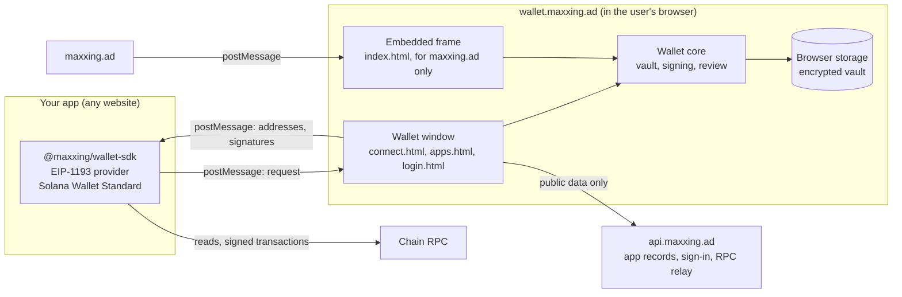
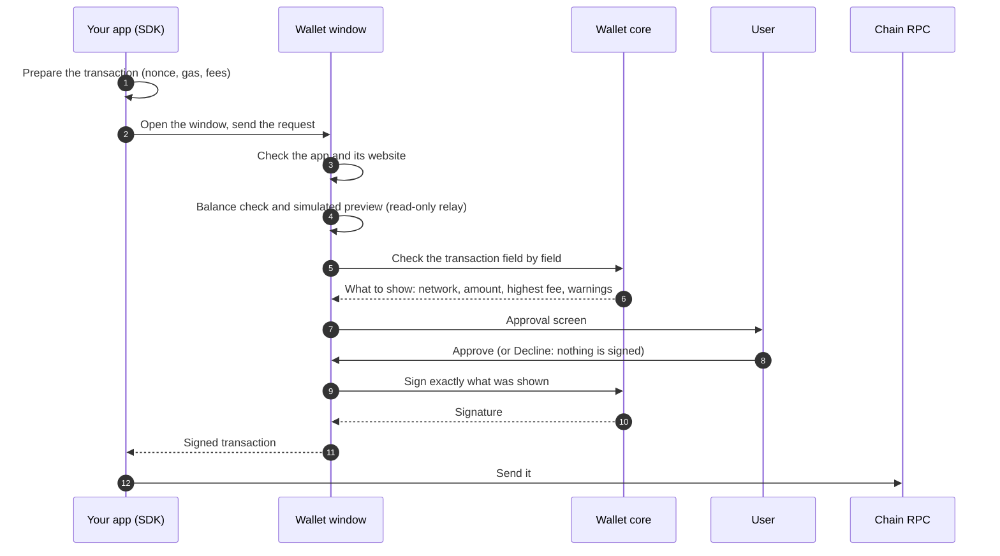

# Architecture

The MAXXING wallet has three parts. Keys exist in only one place: the wallet's pages on `wallet.maxxing.ad`, in the user's
browser. Everything else receives addresses and signatures.

| Part | Runs on | Holds keys | Role |
| --- | --- | --- | --- |
| SDK (`packages/sdk`) | Your app's pages and your server | No | Gives your app a standard provider, opens the wallet window when a request needs the user, and verifies sign-ins on your server. |
| Wallet window (`apps/wallet`) | `wallet.maxxing.ad` | Yes, in memory while open | The pages that hold the wallet: create or restore, PIN, approval screen, connected apps. |
| Wallet core (`packages/core`) | Inside the wallet window | Yes, encrypted at rest | Key derivation, the encrypted vault, signing, and building what the approval screen shows. Makes no network calls. |

## How the parts connect

- **Your app and the wallet window** talk only through `postMessage` between browser windows. The wallet window checks the
  sender's origin, as reported by the browser, against the websites registered for the app.
- **The embedded frame** is a hidden page that maxxing.ad loads so its own pages can use the wallet. Its Content-Security-Policy
  lets only `https://maxxing.ad` and `https://www.maxxing.ad` embed it, and lets it connect to nothing but its own origin.
- **The wallet core** has no network access of its own. A test fails if any core file references `fetch`, sockets, the console,
  other windows or workers.

## A signing request, step by step

Here an app asks the user to sign a transaction on an EVM network.

The private key never leaves the wallet window. If the user declines, the SDK returns error `4001`.

## Where each check happens

| Check | Where |
| --- | --- |
| The request comes from one of the app's registered websites (only localhost while the app is in review) | [`apps/wallet/src/registry.ts`](../apps/wallet/src/registry.ts) |
| Which site counts as maxxing.ad | [`apps/wallet/src/first-party.ts`](../apps/wallet/src/first-party.ts), published per build at `/first-party-apps.json` |
| The approval screen shows the request faithfully, or refuses it | [`packages/core/src/review.ts`](../packages/core/src/review.ts) |
| Every signature is approved first, unless one-tap trading is on | [`apps/wallet/src/consent.ts`](../apps/wallet/src/consent.ts), [`packages/core/src/approvals.ts`](../packages/core/src/approvals.ts) |
| A sign-in message names the site asking and the account signing | [`packages/core/src/sign-in.ts`](../packages/core/src/sign-in.ts) |
| A Solana transaction can't be signed as a plain message | [`packages/core/src/solana-tx.ts`](../packages/core/src/solana-tx.ts) |
| EIP-7702 delegation goes to one fixed contract only | [`packages/core/src/signing.ts`](../packages/core/src/signing.ts) |
| Keys are encrypted at rest and wiped from memory on close | [`packages/core/src/vault.ts`](../packages/core/src/vault.ts), [`packages/core/src/device-session.ts`](../packages/core/src/device-session.ts) |

## On your server

The SDK's server helpers (`@maxxing/wallet-sdk/server`) need no wallet at all. They write and verify Sign-In with Ethereum
messages (EIP-4361, and the same format for Solana), verify the identity tokens that MAXXING issues after a social sign-in, and
verify webhook signatures. See the [SDK guide](../packages/sdk/README.md#verifying-a-wallet-sign-in-on-your-server).

## Related

- [Self-custody](SELF-CUSTODY.md): what is stored, what is sent, and what still depends on MAXXING.
- [Wallet core](../packages/core/README.md): each core file and what it does.
